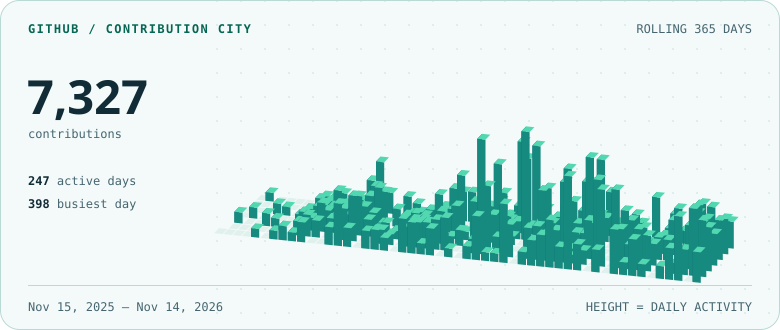
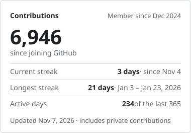
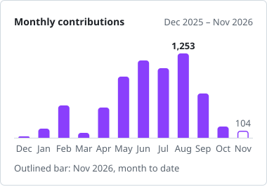

# 

## GitHub activity

<picture>
  <source media="(prefers-color-scheme: dark)" srcset="https://raw.githubusercontent.com/ByGamer01/ByGamer01/stats/city-dark.svg">
  
</picture>

<picture>
  <source media="(prefers-color-scheme: dark)" srcset="https://raw.githubusercontent.com/ByGamer01/ByGamer01/stats/activity-dark.svg">
  
</picture>&emsp;<picture>
  <source media="(prefers-color-scheme: dark)" srcset="https://raw.githubusercontent.com/ByGamer01/ByGamer01/stats/monthly-dark.svg">
  
</picture>

<picture>
  <source media="(prefers-color-scheme: dark)" srcset="https://raw.githubusercontent.com/ByGamer01/ByGamer01/stats/snake-dark.svg">
  
</picture>
